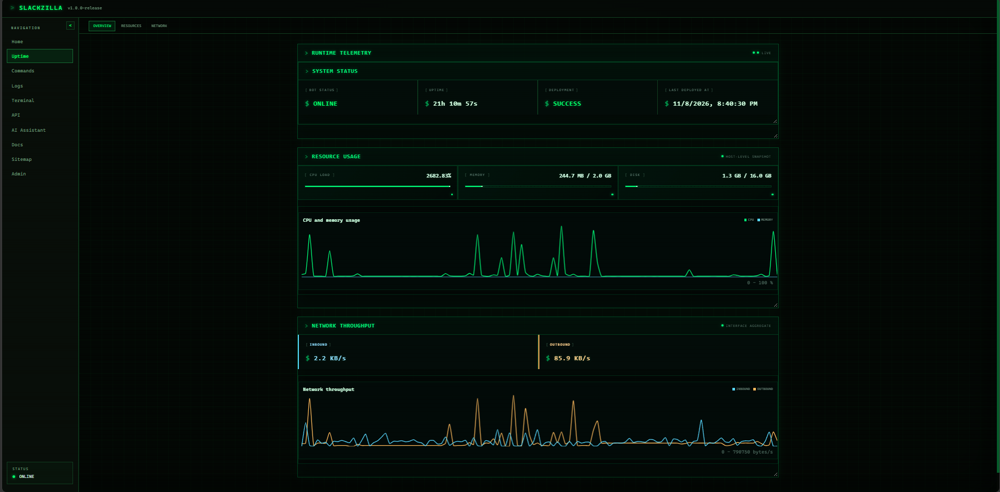
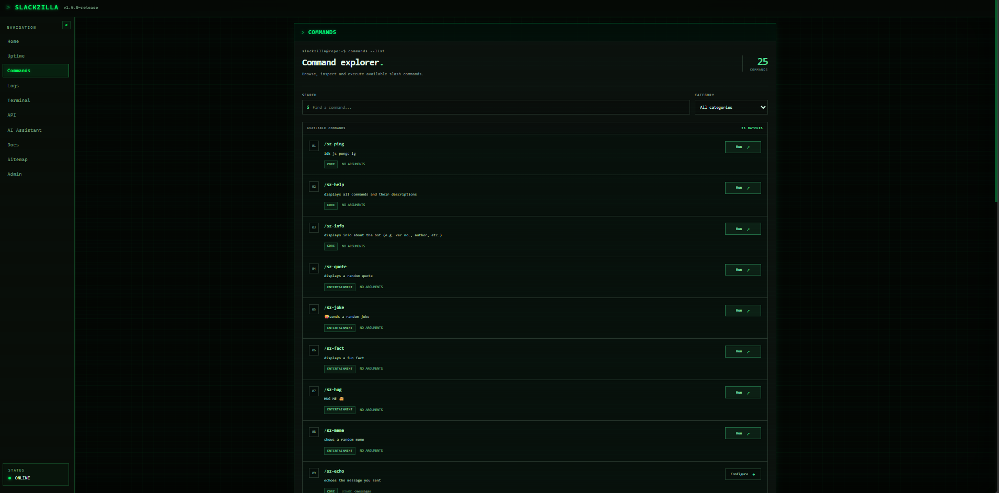
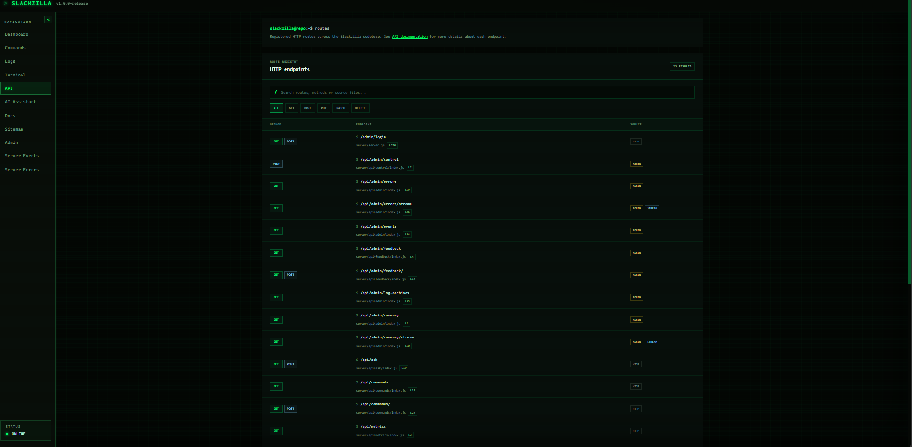
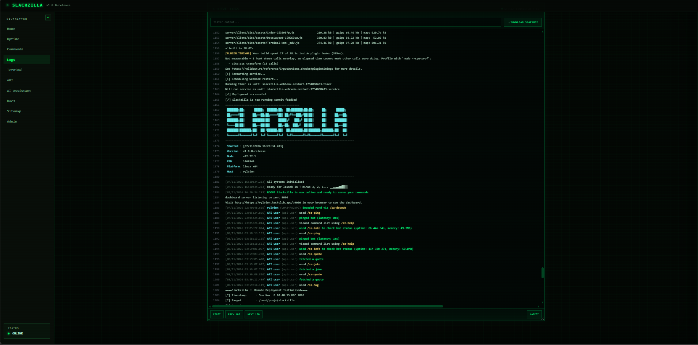
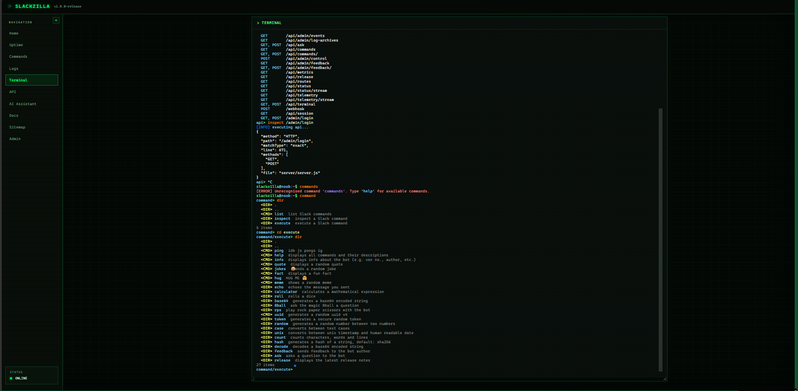
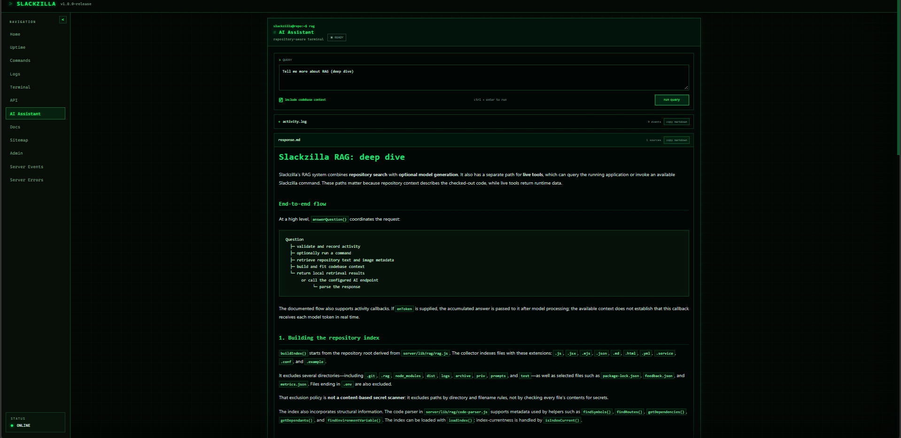
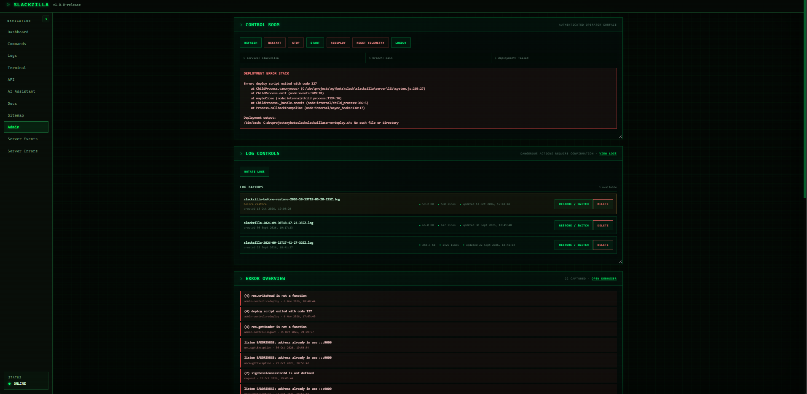
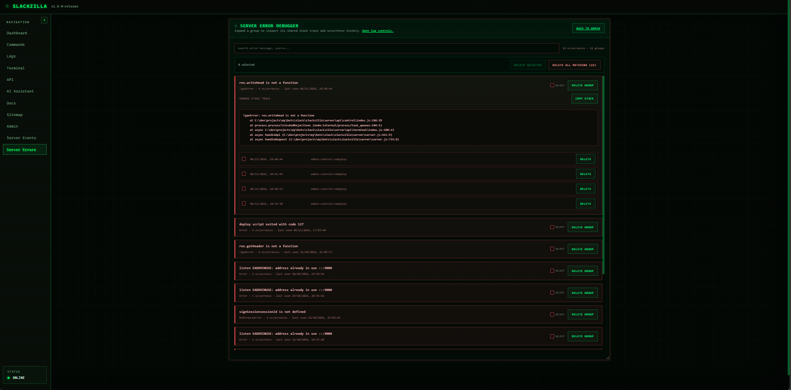
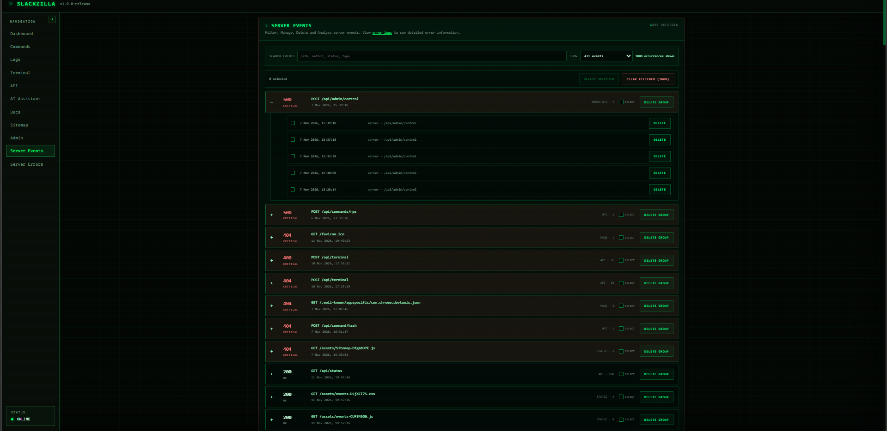

# Welcome to Slackzilla

If your reading this... your're probably reviewing this project anyways, slackzilla is a full stack slack bot with a backend dashboard, api, webhook, AI assistant (with RAG capabilities), and a whole embedded TERMINAL.

here are some links:

- The hosted dashboard: [https://rylvion.hackclub.app](https://rylvion.hackclub.app)
- The Slack Help Server: [https://app.slack.com/client/E09V59WQY1E/C0CFLJA4YUB](https://app.slack.com/client/E09V59WQY1E/C0CFLJA4YUB)
- The Devlogs: [https://stardance.hackclub.com/projects/4967](https://stardance.hackclub.com/projects/4967)

Also a couple of reviewers also like idk, MISSED the help server somehow??? so im putting it here again: [https://app.slack.com/client/E09V59WQY1E/C0CFLJA4YUB](https://app.slack.com/client/E09V59WQY1E/C0CFLJA4YUB). please join it pls

## Slack Commands

All slack commands are listed BELOW AND in [https://rylvion.hackclub.app/commands](https://rylvion.hackclub.app/commands) or you can check in the terminal `command list` or navigate into the `cd command` directory and go to `cd execute` and then type `dir` you can see all the commands there

| Command        | Usage                                             | Description                                                                                                                                                                                    | Category      |
| -------------- | ------------------------------------------------- | ---------------------------------------------------------------------------------------------------------------------------------------------------------------------------------------------- | ------------- |
| `/sz-ping`     | (none)                                            | checks if the bots responsive                                                                                                                                                                  | core          |
| `/sz-help`     | (none)                                            | shows ALL commands and description                                                                                                                                                             | core          |
| `/sz-info`     | (none)                                            | shows ver no., plat, uptime, memory usage, when its started, how much cmds it has and the hosted link                                                                                          | core          |
| `/sz-quote`    | (none)                                            | shows quote                                                                                                                                                                                    | entertainment |
| `/sz-joke`     | (none)                                            | fetches a jooke                                                                                                                                                                                | entertainment |
| `/sz-fact`     | (none)                                            | fun fact                                                                                                                                                                                       | entertainment |
| `/sz-hug`      | (none)                                            | hug ascii art                                                                                                                                                                                  | entertainment |
| `/sz-meme`     | (none)                                            | shows random meme (with gif)                                                                                                                                                                   | entertainment |
| `/sz-echo`     | `<message>`                                       | sends whatever you say back                                                                                                                                                                    | core          |
| `/sz-calc`     | `<expression>`                                    | calculates expression                                                                                                                                                                          | utility       |
| `/sz-roll`     | `<side><n><rolls>+<modifier>`                     | rolls a dice (default 1 to 6)                                                                                                                                                                  | utility       |
| `/sz-base64`   | `<string>`                                        | generates a base64-encoded string                                                                                                                                                              | utility       |
| `/sz-8ball`    | `<question>`                                      | It is certain.                                                                                                                                                                                 | entertainment |
| `/sz-rps`      | `<rock\|1 /paper\|2 /scissors\|3>`                | plays rock paper scissors                                                                                                                                                                      | entertainment |
| `/sz-uuid`     | (none)                                            | generates uuid                                                                                                                                                                                 | utility       |
| `/sz-token`    | `<length>`                                        | min: 1, def: 32, max: 256                                                                                                                                                                      | utility       |
| `/sz-random`   | `<min> <max>`                                     | self explanatory                                                                                                                                                                               | utility       |
| `/sz-case`     | `<camel\|pascal\|snake\|kebab> <text>`            | self explanatory                                                                                                                                                                               | utility       |
| `/sz-unix`     | `<timestamp\|date>`                               | self explanaotry                                                                                                                                                                               | utility       |
| `/sz-count`    | `<text>`                                          | self explanatory                                                                                                                                                                               | utility       |
| `/sz-hash`     | `<algorithm> <encrypt?> <iter?> <salt?> <string>` | generates a hash, default: `SHA-256`. `RSA-MD5`, `RSA-RIPEMD160`, `RSA-SHA1`, `RSA-SHA1-2`, `RSA-SHA224`, `RSA-SHA256`, `RSA-SHA3-224`, `RSA-SHA3-256`, `rand`, `pbkdf2`, `base64`, and `hex`. | utility       |
| `/sz-decode`   | `<algorithm> <string>`                            | decodes `base64`, `hex`, and `rand` data.                                                                                                                                                      | utility       |
| `/sz-feedback` | `<message>`                                       | Sends feedback to me                                                                                                                                                                           | utility       |
| `/sz-ask`      | `<question>`                                      | ask a question                                                                                                                                                                                 | utility       |
| `/sz-release`  | `<version>`                                       | `v[0\|1].[9\|0].[0-6]-[beta\|release]` see help for available versions                                                                                                                         | utility       |

ALL utilities commands have a `help` parameter which tells you how to use it unless its self explanatory and ALL commands can be executed in the [terminal](https://rylvion.hackclub.app/terminal)/[command executor](https://rylvion.hackclub.app/commands)

For terminal commands check [https://hackclub.enterprise.slack.com/docs/T0266FRGM/F0CFV0QG5H7](https://hackclub.enterprise.slack.com/docs/T0266FRGM/F0CFV0QG5H7) for the terminal guide

## Pages

  <table>
    <tr>
      <td align="center" width="50%">
        
        <h3 align="center"><strong>Dashboard</strong></h3>
        
<em>shows last 120 samples of telemetry data for CPU, RAM, netowrk inbound & outbound requests</em>

      </td>
      <td align="center" width="50%">
        
        <h3 align="center"><strong>Commands</strong></h3>
        
<em>lists, categorise, and execute avaiable commands (apart from ask)</em>

      </td>
    </tr>
    <tr>
      <td align="center" width="50%">
        
        <h3 align="center"><strong>API</strong></h3>
        
<em>dynamically generated API routes found by RAG with search & method filters</em>

      </td>
      <td align="center" width="50%">
        
        <h3 align="center"><strong>Logs</strong></h3>
        
<em>view server logs</em>

      </td>
    </tr>
    <tr>
      <td align="center" width="50%">
        
        <h3 align="center"><strong>Terminal</strong></h3>
        
<em><a href="https://hackclub.enterprise.slack.com/docs/T0266FRGM/F0CFV0QG5H7">check terminal guide</a></em>

      </td>
      <td align="center" width="50%">
        
        <h3 align="center"><strong>AI Assistant</st rong></h3>
        
<em>asks questions with codebase context, and tools</em>

      </td>
    </tr>
    <tr>
      <td align="center" width="50%">
        
        <h3 align="center"><strong>Admin</strong></h3>
        
<em>view, manage, delete and execute actions</em>

      </td>
      <td align="center" width="50%">
        
        <h3 align="center"><strong>Errors</strong></h3>
        
<em>view and manage errors</em>

      </td>
    </tr>
    <tr>
      <td align="center" colspan="2">
        
        <h3 align="center"><strong>Events</strong></h3>
        
<em>view and manage all inbound requests</em>

      </td>
      <td align="center" width="50%">
      </td>
    </tr>
  </table>

## Contributing

Contributions are NOT accepted. If you have any issues, bugs, or feature requests, please open an issue on the repository or reach out through the [Slackzilla help Server](https://app.slack.com/client/E09V59WQY1E/C0CFLJA4YUB) and I'll try to help you out.

  <picture>
    <source media="(prefers-color-scheme: dark)" srcset="https://raw.githubusercontent.com/rylvion/slackzilla/output/github-contribution-grid-snake-dark.svg">
    <source media="(prefers-color-scheme: light)" srcset="https://raw.githubusercontent.com/rylvion/slackzilla/output/github-contribution-grid-snake.svg">
    
  </picture>

