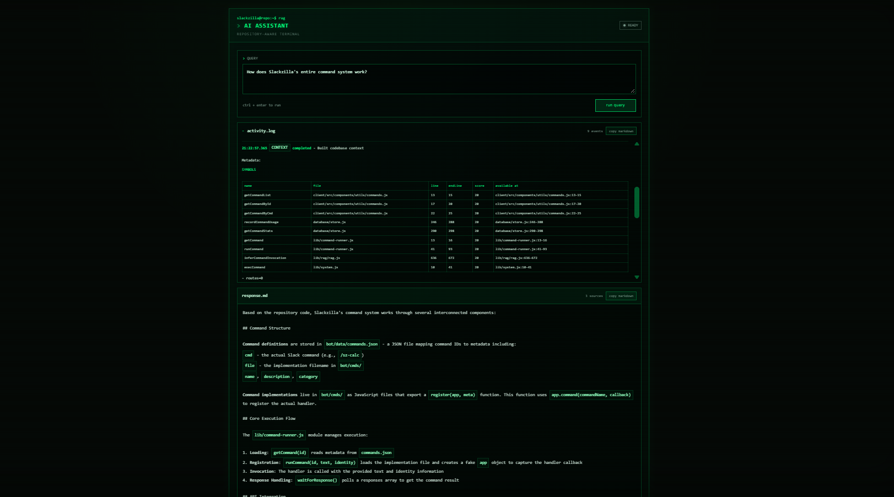

    

# Devlog 10 - QOL DASHBOARD IMPROVEMENTS, RAG ENHANCEMENTS WITH TOOLS & CACING AND LOTS OF STUFF
**time logged:** 27 hrs 30 mins
date: 20/09/2026
version: v0.9.5-beta

This devlog is **COVERING A LOT** of stuff that i did, but im not gonna drag this over like i did from all other devlogs so heres are the features:
> covering from v0.9.1-beta to v0.9.5-beta, see release-history.json for the full changelog

## Features added

* Added RAG TOOLS including
  * `getStatus` - returns the status of the RAG
  * `getCommands` - with enhanced filtering (filter by name, usage hint, id, category and fuzzy filter (makes it easier for RAG to find commands))
  * `getReleaseInfo` - returns the release info of the CURRENT version and (optionally) any other version (pass it by parameter)
  * `runCommand` - runs a command by id
  * `getLogs` - returns recent logs for the RAG to inspect (max 100, default 20)
  * `getMetrics` - returns the metrics of the RAG (memory usage, cpu usage, etc)
  * `getRoutes` - returns the routes of the APIs

* added 3 new scripts (`npm run`) which are

  * `rag` - runs the RAG with or without the `--ai` flag to see context/answer cli
  * `rag:use-tool` - runs a tool by name (with optional parameters)
  * `release` - appends current release notes from `package.json` to `release-history.json`.

* Added new endpoints

  * `/api/telemetry` - returns the telemetry history separately from the main status endpoint
  * `/api/command/:id` - gets or executes a command by id
  * `/api/telemetry/stream` - streams telemetry updates using SSE
  * `/api/admin/server-events` - returns server events for the admin dashboard
  * `/api/ask` - now uses SSE to stream the RAG's activity (*yers now we can see the RAG in aciton*), context, tool usage, token usage and final response

* dashboard imporvements

  * added a seperate admin server events page (wevent searching, filtering, prioritisation and stylying)
  * added a command runner on the command page
  * fixed recent activity not showing up on the dashboard

* Added visible AI activity to the AI page

  * the RAG now emits activity events while processing a question
  * AI page is cached on localStorage so you can go back and forth between pages without losing the AI page state

* Improved the RAG's repository awareness

  * added AST-based parsing using `acorn` and `acorn-walk`
  * added persistent `.rag/index.json`
  * added symbol search and dependency analysis
  * added function, export, function call, environment variable and route extraction
  * added richer code context and source metadata
  * added automatic index rebuilding
  * improved path-based dependency detection
  * fixed the RAG detecting references created using `path.join(rootDir, ...)`
  * add token budgeting and usage tracking.

* Changed how telemetry is handled

  * telemetry history is no longer included in `/api/status` or any other endpoints
  * CHANGED all admin endpoints so that none of them has the `telemetryHistory` anymore 

* Added release history tracking

  * added `release-history.json`
  * `/sz-release` can now retrieve release information for different versions
  * `npm run release` automatically appends the current release notes

Tl;DR: RAG got a major upgrade with AST-powered repository indexing (acorn/acorn-walk), persistent indexing via `.rag/index.json`, symbol search, dependency analysis, function/export/call/env-var/route extraction, richer source metadata, automatic index rebuilding, 7 new RAG tools, 3 new CLI tools, SSE-powered streaming for `/api/ask` and telemetry, telemetry endpoints, admin server events, live AI activity tracing, token/context/tool usage visibility, AI session caching, release history tracking, telemetry separation from /api/status, admin API cleanup, and a large collection of bug fixes, repository-awareness improvements and major QOL improvements.
.
hopefully i will be devloging every day till i ship

---

<a href="devlog9.md">
  <picture>
    <source media="(prefers-color-scheme: dark)" srcset="https://cdn.hackclub.com/019c1b78-0beb-7c82-9479-51e12c90a5b4/image.png">
    
  </picture>
</a>

  <em>
    <b>
      <a href="#">
        visit non existent devlog 11 (coming soon)
      </a>
    </b>
  </em>

