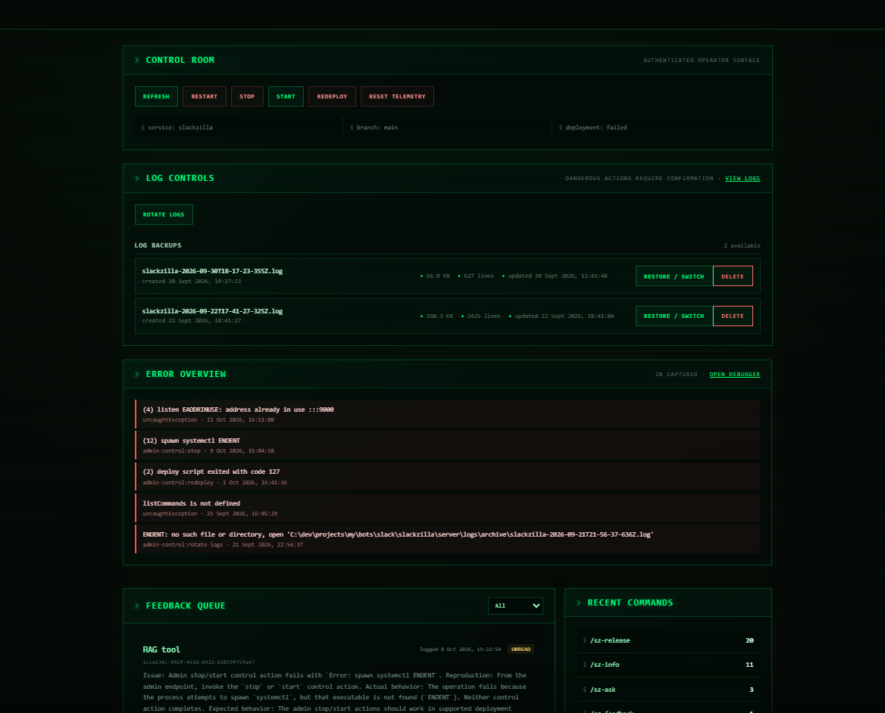
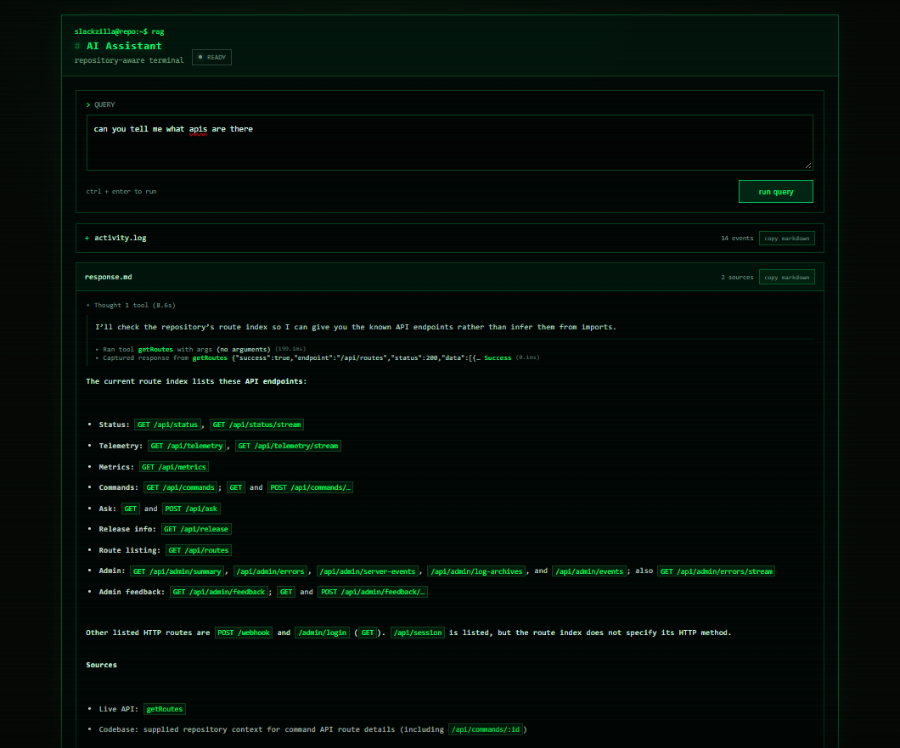

# devlog 11 - ADMIN EHANCEMENTS: errors views, log archiving & restoration, logs deletion controls, RAG IMPROVEMENTS AND MORE...
**time logged:** 31hr 55m
**version:** v0.9.6-beta

this release focused on making Slackzilla easier to debug, manage and understand internally. a LOT of work went into the admin panel, route extraction and testing.

## 1. admin panel got some SERIOUS upgrades

added **3 new admin pages** for server events, errors and logs. also split `admin.css` into separate stylesheets because one giant stylesheet isn't exactly a maintenance strategy.

### error monitoring
- added an error viewer with timestamps, stack traces and source files
- improved error messages to make them more user-friendly

### log management
- added a log archive viewer with backup timestamps, line counts and file sizes
- added backup restoration and switching
- added controls to delete specific lines, ranges or the last X lines
- added log rotation and telemetry reset controls
- added the `/log-archives` admin endpoint

**7 new admin controls:** `delete-logs`, `delete-lines`, `delete-last`, `delete-line`, `rotate-logs`, `restore-log` and `reset-telemetry`

that's a LOT more control over server logs than before.

## 2. endpoints & session security

added **4 new endpoints**:

- **3 admin endpoints:** `/errors`, `/errors/stream`, `/log-archives`
- **1 public endpoint:** `/api/session`

`/api/session` now provides current session information, with `csrfToken` moved from `/api/admin/summary` to the new endpoint.

also fixed the CSRF token not appearing in the document head. small bug, annoying consequences.

removed the `children=[]` pattern from `routes.js` and its associated dependencies.

## 3. RAG / code parser improvements

route extraction got a substantial upgrade.

- detects routes using exact path checks, prefix checks and array-based matching
- improved HTTP method inference for conditional routes, including GET and POST
- merges duplicate route entries and inferred methods
- expanded discovery beyond `server/api/`, including `/webhook` and `/admin/login`
- improved `/api/routes` to return supported methods, match types, source files and line numbers

the goal: give the RAG system more accurate route information instead of confidently retrieving incomplete or duplicated data.

**ᕦ(ò_óˇ)ᕤ**

## 4. AI activity & markdown

the AI activity view now displays elapsed time alongside tool summaries and responses, making it easier to follow what the system actually did.

replaced the custom Markdown parser with `marked` AND `dompurify` for established parsing and HTML sanitisation.

switched the configured model from `openrouter/free` to `openai/gpt-6-luna`, aiming for better performance and reliability.

also deduplicated `getReleaseInfo` to avoid maintaining redundant version information.

## 5. testing

added **3 npm scripts**:

- `test:code-parser` for code parser tests
- `test:rag` for RAG tests
- `test:all` for the broader test suite and validation checks

added automated code parser tests covering route extraction, HTTP method inference and deduplication.

## 6. docs

updated `README.md` and project documentation to reflect the latest endpoints, admin controls, route extraction changes and RAG improvements.

documentation staying in sync with the codebase. revolutionary concept, apparently.

## release summary

**v0.9.6-beta added:**
- **4 endpoints**
- **7 admin controls**
- **3 admin pages**
- **3 npm testing scripts**
- improved error visibility, log management, session information and route extraction
- updated Markdown rendering, AI activity information and documentation

the main focus was improving maintainability, debugging and the reliability of Slackzilla's internal tooling.

**( ͡° ͜ʖ ͡°)**

---

**next devlog hint:** a terminal is coming.

think less clicking through admin pages, more interacting with Slackzilla directly through a terminal interface. details in the NEXT devlog.

**＼(^o^)／**

---
---

<a href="devlog10.md">
  <picture>
    <source media="(prefers-color-scheme: dark)" srcset="https://cdn.hackclub.com/019c1b78-0beb-7c82-9479-51e12c90a5b4/image.png">
    
  </picture>
</a>

  <em>
    <b>
      <a href="#">
        visit non existent devlog 12 (coming soon)
      </a>
    </b>
  </em>

