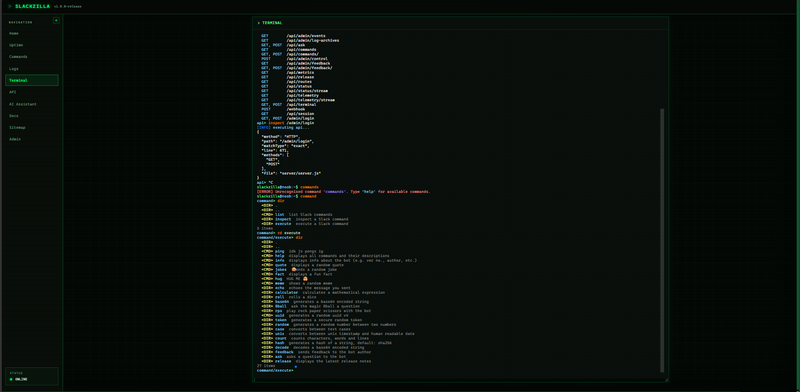

    

# Devlog 12 - TERMINAL ADDITION, DYNAMIC DOCS LOADING AND MORE

Full release of `v1.0.0-release` slackzilla, im srry guys but theres literally 3 minutes on the clock so i cant spend the time to devlog but this is just gonna be an overview of what i did (not all) see full release notes in github `release-history.json` or `package.json`

**Slackzilla v1.0.0-release is here!**

### Part 1: Dashboard, API, Docs & RAG

- Added 7 admin controls and improved event/error grouping, management and rate-limit feedback.
- Overhauled the dashboard UI, with draggable/resizable panels, a collapsible sidebar and improved API, Commands and Docs pages.
- Added AI response cancellation with an AbortController-powered Stop button.
- Improved code parsing, cross-file inference and RAG retrieval, including better image information and keyword matching.
- Added `runAPICommand` and `runTerminalCommand` RAG tools.
- Improved API rate limiting and route detection.
- Added loads of tests and automatic documentation synchronisation with the GitHub Wiki.
- Made Command Page Interactive

### Part 2: Embedded Terminal

- Added an interactive terminal at `/terminal` using xterm.js and FitAddon.
- Introduced 9 local commands and 8 backend commands
- Added API, documentation, RAG, server status, logs and Slack command inspection.
- Added command history, virtual directories, encoding utilities and interactive command contexts.
- Introduced `sudo` for privileged operations, with admin re-authentication and confirmation prompts.
- Added terminal session restoration and ANSI output preservation.

---

<a href="devlog11.md">
  <picture>
    <source media="(prefers-color-scheme: dark)" srcset="https://cdn.hackclub.com/019c1b78-0beb-7c82-9479-51e12c90a5b4/image.png">
    
  </picture>
</a>

  <em>
    <b>
      <a href="https://app.slack.com/client/E09V59WQY1E/C0CFLJA4YUB">
        visit help server 
      </a>
    </b>
  </em>

  <em>
    <b>
      <a href="https://rylvion.hackclub.app">
        visit hosted dashboard
      </a>
    </b>
  </em>

