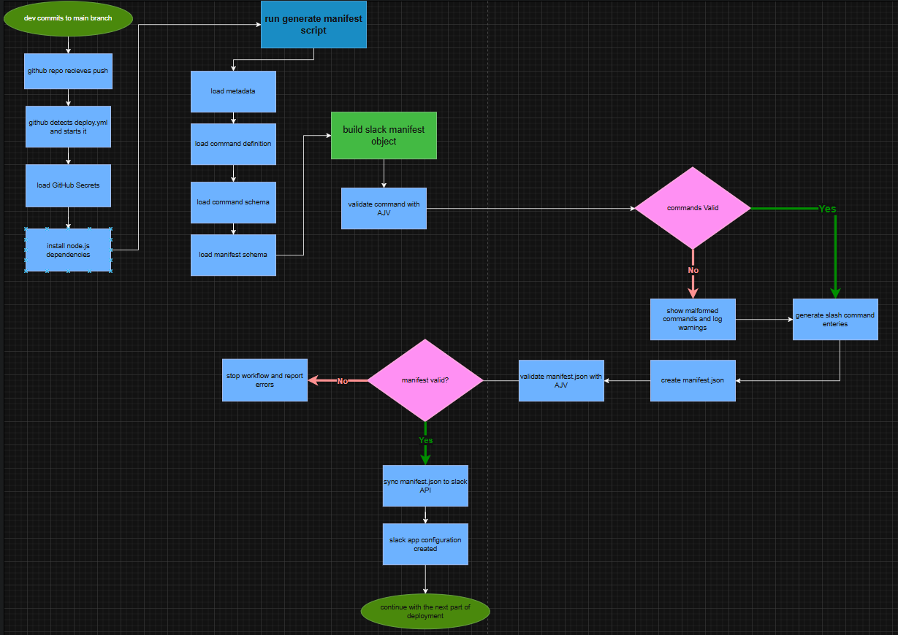
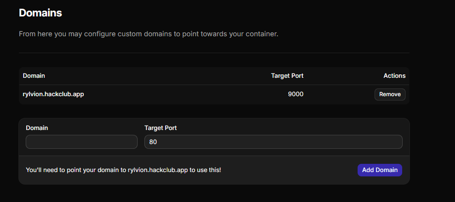

# Slackzilla Architecture

**Last updated at:** _05/10/2026_

## TOC (Table of Contents)

| Section                                         | Description                                           |
| ----------------------------------------------- | ----------------------------------------------------- |
| [Repository Layout](#repository-layout)         | File and directory responsibilities                   |
| [Process Lifecycle](#process-lifecycle)         | Bot and server processes                              |
| [HTTP Request Dispatch](#http-request-dispatch) | Request routing and API modules                       |
| [React Request Flow](#react-request-flow)       | React Router and API requests                         |
| [Data Flow and Storage](#data-flow-and-storage) | File-backed store and telemetry                       |
| [Deployment](#deployment)                       | GitHub Actions workflow and webhook                   |
| [Manifest Workflow](#manifest-workflow)         | Slack manifest generation and rotation                |
| [Reverse Proxy](#reverse-proxy)                 | Hack Club Nest domain configuration                   |
| [Extension Rules](#extension-rules)             | Extension guides and rules                            |
| [Command Architecture](#command-architecture)   | Command registration, execution, and shared utilities |

This document describes the active architecture in this repository. Slackzilla uses two Node.js processes and a shared file-backed store. It does not use Express, a database server, or automatic module discovery.

The bot maintains the Slack connection and executes commands. The dashboard server provides HTTP pages, APIs, authentication, telemetry, logs, and deployment handling. Both processes can read and write shared files under `server/database/` and `server/logs/`.

## Repository Layout

| Path                       | Responsibility                                                              |
| -------------------------- | --------------------------------------------------------------------------- |
| `bot/bot.js`               | Creates the Slack Bolt Socket Mode app and loads commands.                  |
| `bot/cmds/`                | Command implementations registered with `app.command()`.                    |
| `bot/data/commands.json`   | Command metadata, usage hints, descriptions, and command name               |
| `bot/utils/`               | Bot logging, fetching, command loading, and metrics adapters.               |
| `server/server.js`         | HTTP server, request dispatch, static files, APIs, pages, webhook, and SSE. |
| `server/api/`              | Explicit API handler modules.                                               |
| `server/lib/auth.js`       | Password verification, login challenges, sessions, cookies, and CSRF.       |
| `server/lib/system.js`     | CPU, memory, disk, network, Git, service, and deployment helpers.           |
| `server/lib/http.js`       | HTTP helpers for request parsing, response writing, and SSE.                |
| `server/database/store.js` | File-backed persistence adapter.                                            |
| `server/client/src/`       | React dashboard source. Vite outputs `server/client/dist/`.                 |
| `server/logs/`             | Raw log output and rotated log archives.                                    |
| `server/lib/rag/`          | All the main files for the RAG assistant                                    |

## Process Lifecycle

`npm start` builds and lints the dashboard, then starts the bot and dashboard concurrently. Production service files run them separately: `slackzilla.service` starts the bot and `slackzilla-webhook.service` starts `server/server.js`.

The bot connects to Slack through Socket Mode using `SLACK_APP_TOKEN` and authenticates Web API calls with `SLACK_BOT_TOKEN`. The dashboard listens on `PORT`, normally `9000`, and serves browser traffic and the GitHub webhook. A reverse proxy can expose that one port over HTTPS.

## Command Architecture

Slackzilla's command system handles Slack slash commands through the Slack Bolt application running in `bot/bot.js`. Command implementations are stored in `bot/cmds/`, while `bot/data/commands.json` provides metadata used to describe commands and their usage.

The bot initialises Slack Bolt with Socket Mode and registers command handlers using `app.command()`. Command implementations are loaded through the bot's command-loading utilities in `bot/utils/`. `bot/data/commands.json` acts as the command metadata source, containing command names, descriptions, usage hints, and other information used by the application. This metadata is separate from the executable command implementations. Command registration is handled explicitly by the bot's loading system. The HTTP server does not register or execute Slack slash commands.

When a user invokes a registered slash command in Slack, Slack Bolt dispatches the incoming command to its registered handler. The corresponding command implementation processes the request and produces the appropriate response. The general execution path is:

1. Slack sends the slash command through the Slack API.
2. The Slack Bolt application receives the command through Socket Mode.
3. The registered handler dispatches execution to the relevant command implementation.
4. The command performs its required operations, which may include using shared utilities, reading application state, or interacting with external services.
5. The handler returns the appropriate response to Slack.
6. Command activity and relevant metrics are recorded through the bot's logging and metrics utilities.

The exact operations performed depend on the individual command implementation.

Command implementations can use the shared utilities in `bot/utils/` for common functionality, including logging, fetching, command loading, and metrics integration. This keeps reusable behaviour separate from individual command handlers. The bot and dashboard server are separate Node.js processes, but both can access the shared file-backed data under `server/database/` and the log output under `server/logs/`. This allows command activity to contribute to information displayed by the dashboard without requiring the HTTP server to execute the commands itself.

A new command should follow the existing command implementation conventions, use the appropriate metadata entry in `bot/data/commands.json`, and integrate with the existing loading, logging, and metrics mechanisms where applicable. See [The Command Extension Guide](command-extension-guide.md) for how to add new commands and the repository's current implementation rules.

## HTTP Request Dispatch

The server uses Node's `http.createServer()`. `handleRequest()` parses the URL, applies security headers, and checks handlers in this order:

1. `handleStatic()` serves built assets and repository attachments.
2. `handleWebhook()` verifies and processes GitHub webhook requests.
3. `handleAdminLogin()` handles the login challenge and credential exchange.
4. `handleApi()` asks each API module whether it owns the request.
5. `handleReactApp()` serves the React `index.html` for browser routes.
6. Unmatched requests receive `404 Not found`.

An API module receives `{ req, res, url, context }`. It checks both `url.pathname` and `req.method`, sends a response, and returns `true` when it handled the request. It returns `false` when another handler should continue. API modules are imported and called explicitly in `server.js`.

Successful JSON responses normally use `{ ok: true, data }`; errors use `{ ok: false, code, error }`. `parseBody()` accepts JSON and URL-encoded form data. SSE handlers keep a response open and use `sendSse()` to emit named events.

## React Request Flow

The browser loads `server/client/dist/index.html`, then React Router selects a page from `server/client/src/components/utils/routes.js`. Pages use `PageShell` for the header, navigation, and content area. API requests use `fetch()` or `getJson()`. Status and admin pages subscribe to SSE streams for updates.

A React route and a backend route are separate. The React route decides which component renders in the browser; the server handler decides which HTTP request is served. The frontend API registry documents endpoints but does not mount them.

## Data Flow and Storage

`server/database/store.js` is an adapter-shaped module implemented with JSON files:

- `metrics.json`: command totals, users, channels, recent command events, and bounded server request events.
- `bot-state.json`: bot heartbeat, PID, version, platform, and status.
- `feedback.json`: feedback entries and response state.
- `deployment.json`: deployment status, commit, output, and result.
- `server/logs/slackzilla.log`: raw terminal-style log output.

Writes are synchronous read-modify-write operations. This is simple for a small self-hosted deployment, but it is not transactional storage under high concurrency. A future database adapter should preserve the store function API and add migrations, indexes, retention, and atomic writes.

## Telemetry

The dashboard refreshes runtime telemetry once per second. CPU is calculated from Node process CPU deltas divided by elapsed wall time and normalised by CPU core count. Host memory uses `os.totalmem()` and `os.freemem()`. Disk uses `fs.statfsSync()` with fallback paths. Linux network counters come from `/proc/net/dev`; Windows counters come from `netstat -e`.

The server keeps the latest 120 samples in memory for charts (in memory [temp] not on disk, accessed through `/api/telemetry`). Bot command events and server request events are persisted and capped at 1,000 entries. These limits prevent unbounded memory and file growth.

The admin dashboard can delete the existing telemetry history and reset the counters, via an authenticated request to `POST /api/admin/control/` with a JSON payload of `{ "action": "reset-telemetry", "confirmed": true, "csrf": "<token>" }`. The server will respond with `{ "ok": true, "data": { "action": "reset-telemetry" } }` and delete the telemetry history from memory and disk. The `confirmed` field is required since the frontend will prompt the user for confirmation before sending the request. The `csrf` field is required to prevent cross-site request forgery attacks.

## Deployment

<div align="center">
    
</div>

Slackzilla uses GitHub Actions to automate deployments when changes are pushed to the configured deployment branch. The workflow performs the required build, validation and synchronisation steps before notifying the Slackzilla webhook that a deployment is ready to run.

The workflow sends the deployment notification using a dedicated `POST /webhook` request. Before sending the request, it constructs a reduced payload containing the GitHub reference, commit SHA, repository information and workflow sender:

```json
{
    "ref": "refs/heads/main",
    "after": "<commit-sha>",
    "repository": {
        "full_name": "<owner>/<repository>",
        "default_branch": "main"
    },
    "sender": {
        "login": "github-actions"
    }
}
```

The workflow does not forward GitHub's complete native push event. This keeps the webhook payload limited to the information required by Slackzilla.

The request is authenticated using an `HMAC-SHA256` signature generated from the exact request body and `WEBHOOK_SECRET`. The resulting signature is sent through `X-Hub-Signature-256`, alongside the `X-GitHub-Event` and `X-GitHub-Delivery` headers.

```js
signature="sha256=$(printf '%s' "$payload" | openssl dgst -sha256 -hmac "$WEBHOOK_SECRET" -hex | awk '{print $2}')"
```

The workflow then sends the signed payload to `WEBHOOK_URL` using curl. Both `WEBHOOK_URL` and `WEBHOOK_SECRET` are stored as GitHub repository secrets and the workflow stops if either is missing. The Slackzilla webhook receives the request and first verifies the `HMAC` signature against the raw request body. Requests with an invalid or missing signature are rejected before the payload is processed. After authentication, Slackzilla parses the `JSON` payload and checks that the request is a push event targeting the configured deployment branch. Requests for other event types or branches are acknowledged but ignored.

A valid deployment request is recorded as queued and the commit from `payload.after` is stored. Slackzilla then sends the HTTP 202 response to GitHub Actions and broadcasts the queued state to connected admin clients. The deployment itself is executed after the response has been sent, preventing GitHub Actions from having to wait for the complete deployment process.

See [webhook.md](webhook.md#request) for the complete webhook request contract, signature verification, event filtering, response codes and local testing procedure.

## Manifest Workflow

<div align="center">
    
</div>

The manifest workflow keeps the Slack app configuration generated from the repository rather than maintaining the Slack manifest manually. `npm run generate-manifest` runs the manifest generation script, which reads the bot metadata from `bot/meta.js`, slash command definitions from `bot/data/commands.json`, the command and manifest schemas, and the current package version. It validates command entries against the command schema, builds the Slack manifest including bot information, slash commands, OAuth scopes, Socket Mode settings and optional event subscription or token rotation settings, then writes the resulting configuration to `manifest.json`. Malformed command entries are skipped with a warning, while missing required metadata or an invalid generated manifest causes the workflow to fail.

The generated `manifest.json` is then validated independently using `npm run validate-manifest`, which runs AJV against `schemas/manifest.schema.json`. This provides a second validation stage before any changes are sent to Slack.

Once validation succeeds, `scripts/rotateManifestToken.js` rotates the Slack manifest token using the existing `SLACK_REFRESH_TOKEN`. The returned access and refresh tokens are checked, with the access token exposed to the workflow through `GITHUB_OUTPUT` and masked in the GitHub Actions logs. The script then uses the GitHub API to encrypt and update both `SLACK_MANIFEST_TOKEN` and `SLACK_REFRESH_TOKEN` repository secrets, ensuring the newly rotated credentials are retained for future workflow runs.

Finally, the workflow reads `manifest.json` and sends it to Slack's `apps.manifest.update` API using the newly rotated manifest token and `SLACK_APP_ID`. The response is parsed and its `ok` value is checked. If Slack reports a failure, the workflow exits with an error rather than treating the deployment as successful. After the workflow is finished it moves on to the [deployment workflow](#deployment) to complete the deployment process.

## Reverse Proxy

~~Nginx is installed as a reverse proxy for Slackzilla and listens on port `80`. It matches requests for `rylvion.hackclub.app` and forwards them to the Node.js server running on `localhost:9000`. The proxy preserves the requested hostname through the `Host` header and passes the original client address through `X-Real-IP`. This can be tested locally by sending a request to port `80` with `Host: rylvion.hackclub.app`, which returns the same Slackzilla application served directly by port `9000`. The active Nginx configuration is located at `server/sites-enabled/slackzilla.conf` ~~

<div align="center">
    
</div>

In [Hack Club Nest](https://hackclub.app), the Domains configuration maps [rylvion.hackclub.app](https://rylvion.hackclub.app) to the container's target port 9000. Public requests are therefore handled by Hack Club/Nest's external routing infrastructure and forwarded to port 9000 inside the container, where Slackzilla is listening. The `rylvion.hackclub.app` domain does not point directly to Nginx on port 80; the Nest domain configuration is what associates the hostname with the container's port 9000.

## Extension Rules

See [extension-index](extension/README.md) for a list of guides and rules for extending Slackzilla with new commands, APIs, and pages. The extension rules are designed to keep the architecture simple, explicit, and maintainable.
