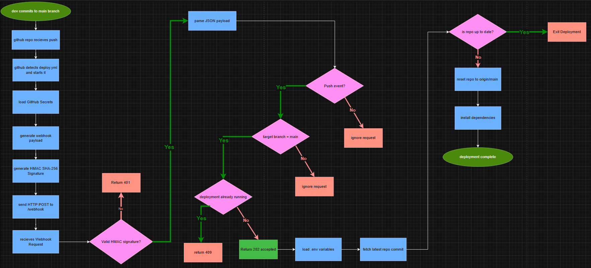

# Slackzilla Server Setup

## Architecture

Slackzilla runs two systemd services on a Debian/Ubuntu server:

| Service                      | Entry point        | Purpose                                         |
| ---------------------------- | ------------------ | ----------------------------------------------- |
| `slackzilla.service`         | `bot/bot.js`       | Connects to Slack and runs the bot              |
| `slackzilla-webhook.service` | `server/server.js` | Hosts the dashboard, API and deployment webhook |

The Node.js server listens on port `9000`. Nginx can optionally proxy public traffic to it. Environment variables and credentials are stored separately in `bot/.env` and `server/.env`.

## Deployment

<div align="center">
    
</div>

Deployments are handled automatically through GitHub Actions. GitHub Actions also requires `SLACK_REFRESH_TOKEN`, `GH_SECRET_PAT`, `SLACK_APP_ID`, `WEBHOOK_URL` and `WEBHOOK_SECRET`.

For a fresh Debian/Ubuntu server, clone the repository and run the setup script:

```bash
git clone https://github.com/rylvion/slackzilla.git ~/projs/slackzilla
cd ~/projs/slackzilla
bash server/server-setup.sh
```

The script installs the required dependencies (including node.js and nginx), clones or reuses the project checkout, installs npm packages, creates the environment files and configures both systemd services.

After setup, edit `bot/.env` & `server/.env` with your Slack credentials and configure the GitHub Actions webhook secrets and URL. Also this is a dangerous destructive script, so make sure you read it before running it.


## Related Files

- [`server/deploy.sh`](../server/deploy.sh): deployment script
- [`server/slackzilla.service`](../server/slackzilla.service) - slack bot
- [`server/slackzilla-webhook.service`](../server/slackzilla-webhook.service): dashboard & apis
- [`server/.env.example`](../server/.env.example): server config
- [`bot/.env.example`](../bot/.env.example): bot config
- [`webhook.md`](webhook.md): webhook docs.
